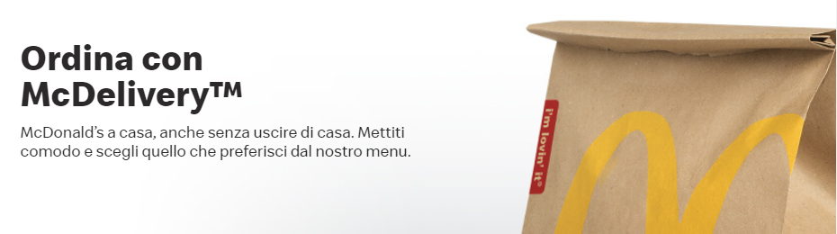

<div align="center">

# 🍟 McDelivery

**Web application per ordinare prodotti McDonald's online, con aree dedicate a clienti, corrieri, responsabili del personale e product manager.**


*Progetto universitario, Università degli Studi di Salerno*



</div>

---

## 📑 Indice

- [Panoramica](#-panoramica)
- [Funzionalità per ruolo](#-funzionalità-per-ruolo)
- [Architettura](#️-architettura)
- [Struttura del progetto](#-struttura-del-progetto)
- [Base di dati](#️-base-di-dati)
- [Tecnologie](#️-tecnologie)
- [Come eseguire](#-come-eseguire)
- [Documentazione](#-documentazione)
- [Autori](#-autori)

---

## 🔎 Panoramica

**McDelivery** è una web application Java EE (JSP + Servlet) che simula un servizio di consegna a domicilio McDonald's appoggiato a una rete di McDrive.
I clienti consultano il catalogo, riempiono il carrello e confermano l'ordine scegliendo il McDrive; i corrieri prendono in carico le consegne; lo staff gestisce personale, prodotti e offerte.

Il progetto è accompagnato dalla documentazione di ingegneria del software (Problem Statement, RAD, SDD, ODD, Test Plan, Test Case Specification, Test Execution Report) nella cartella [`deliverables/`](deliverables).

---

## ✨ Funzionalità per ruolo

All'accesso il ruolo viene ricavato dal campo `tipo` dell'account e salvato in sessione; ogni servlet verifica il ruolo prima di eseguire l'operazione.

| `tipo` | Ruolo | Funzionalità |
|:-:|---|---|
| `0` | 🧑 **Utente** (cliente) | Catalogo per categoria, offerte attive, carrello (aggiunta, modifica quantità, rimozione, svuotamento), conferma dell'ordine su un McDrive, elenco dei McDrive con mappa ("Dove trovarci") |
| `1` | 🛵 **Corriere** | Scelta di un McDrive, elenco degli ordini da consegnare, presa in carico di un ordine, riepilogo delle consegne effettuate nella sessione |
| `2` | 👔 **Responsabile del personale** | Elenco dei corrieri, assunzione di un nuovo corriere, licenziamento (eliminazione dell'account) |
| `3` | 📦 **Product manager** | Inserimento, modifica ed eliminazione dei prodotti (con upload della foto), impostazione degli sconti per le offerte |

Funzionalità comuni:
- 📝 **Registrazione** di nuovi clienti, con controllo AJAX della disponibilità dell'e-mail (`CheckMailServlet`);
- 🔐 **Login/Logout** con password salvate come hash **SHA-256** e opzione "ricordami" (sessione più lunga);
- 👤 **Area personale**: modifica di nome e cognome, indirizzo e password;
- 🛡️ Filtro `HttpHeaderSecurityFilter` di Tomcat (protezione XSS e anti-clickjacking) e pagina di errore personalizzata.

Categorie di prodotti: **bevande**, **gelati e dessert**, **insalate**, **menu**, **panini**, **sfiziosità**.

---

## 🏛️ Architettura

L'applicazione segue un'architettura **MVC**:

```
Browser ──► Servlet (it.unisa.control) ──► DAO (it.unisa.dao) ──► MySQL
   ▲               │                           │
   └──── JSP ◄─────┴──── Bean (it.unisa.bean) ◄┘
```

| Livello | Package / cartella | Contenuto |
|---|---|---|
| **Model** | `it.unisa.bean` | `UtenteBean`, `ProductBean`, `OrdineBean`, `McDriveBean`, `Cart` |
| **Accesso ai dati** | `it.unisa.dao` | DAO per ruolo (`UtenteDao`, `ProdottoDao`, `CorriereDAO`, `ResponsabilePersonaleDao`, `ProductManagerDao`) e pool di connessioni `DriverManagerConnectionPool` |
| **Controller** | `it.unisa.control` | Servlet annotate con `@WebServlet` (login, registrazione, carrello, consegne, dipendenti, prodotti...) |
| **View** | `WebContent/*.jsp` | Pagine JSP con Bootstrap, jQuery e CSS personalizzati |
| **Test** | `it.unisa.test` | Test JUnit 4 sui DAO |

---

## 🗂️ Struttura del progetto

```
McDonald-s/
├── codice/McDelivery/
│   ├── db/
│   │   ├── mcdelivery.sql        # Schema, utente MySQL e dati di esempio
│   │   └── pwd.txt               # Dati di supporto per gli account di prova
│   ├── src/it/unisa/
│   │   ├── bean/                 # JavaBean del dominio
│   │   ├── control/              # Servlet (controller) e utility SHA-256
│   │   ├── dao/                  # Data Access Object e connection pool
│   │   └── test/                 # Test JUnit dei DAO
│   └── WebContent/
│       ├── *.jsp, *.css          # Pagine e stili
│       ├── img/                  # Immagini del sito e dei prodotti
│       ├── Speedee/              # Font web
│       └── WEB-INF/
│           ├── web.xml           # Welcome page, error page, filtro di sicurezza
│           └── lib/              # mysql-connector-java 8.0.12, JUnit 4.13.1, Hamcrest
└── deliverables/                 # Documentazione di progetto (.docx/.pptx e PDF)
```

---

## 🗄️ Base di dati

Database **`mcdelivery`** (script [`codice/McDelivery/db/mcdelivery.sql`](codice/McDelivery/db/mcdelivery.sql)):

| Tabella | Descrizione |
|---|---|
| `account` | Utenti (e-mail, hash SHA-256 della password, nome, cognome, `tipo`, numero di ordini) |
| `indirizzoAcc` | Indirizzo associato a un account |
| `prodotto` | Prodotti con prezzo, categoria (`tipo`), sconto e percorso della foto |
| `mcdrive` / `indirizzo` | Punti vendita e relativi indirizzi |
| `ordine` | Ordini (data, numero, totale, cliente, McDrive, flag `preso_in_carico`) |
| `possiede` | Prodotti e quantità di ciascun ordine |

---

## 🛠️ Tecnologie

| Ambito | Tecnologie |
|---|---|
| Backend | Java, Servlet API 4.0 (`javax.servlet`), JSP, JDBC |
| Server | Apache Tomcat |
| Database | MySQL, MySQL Connector/J 8.0.12 |
| Frontend | HTML, CSS, Bootstrap 4, jQuery, AJAX |
| Test | JUnit 4.13.1, Hamcrest |

---

## 🚀 Come eseguire

### Prerequisiti
- JDK 8 o superiore
- **Apache Tomcat 9** (Servlet 4.0 con package `javax.*`; Tomcat 10+ usa `jakarta.*` e non è compatibile)
- MySQL 8
- Un IDE come Eclipse IDE for Enterprise Java (consigliato)

### 1. Database
Lo script crea il database, l'utente applicativo e i dati di esempio:

```bash
mysql -u root -p < codice/McDelivery/db/mcdelivery.sql
```

Parametri di connessione usati in `DriverManagerConnectionPool`:

| Parametro | Valore |
|---|---|
| URL | `jdbc:mysql://localhost:3306/mcdelivery?serverTimezone=UTC` |
| Utente | `mcdelivery` |
| Password | `adminadmin` |

### 2. Applicazione (Eclipse)
1. *File → New → Dynamic Web Project* chiamato `McDelivery`, poi copia `src/` e `WebContent/` da `codice/McDelivery/` (in alternativa configura queste cartelle come sorgenti e web root).
2. Verifica che i JAR in `WebContent/WEB-INF/lib` siano nel build path e aggiungi il runtime di Tomcat 9 (necessario anche per i test, che importano classi di Tomcat).
3. *Run As → Run on Server* e apri `http://localhost:8080/McDelivery/` (pagina iniziale `Index.jsp`).

### 3. Account di prova
Lo script crea account per tutti e quattro i ruoli.

---

## 📚 Documentazione

| Documento | Sorgente | PDF |
|---|---|---|
| Problem Statement | [docx](deliverables/Problem%20statement.docx) | [pdf](deliverables/PDF/Problem%20statement.pdf) |
| Requirements Analysis Document (RAD) | [docx](deliverables/RAD.docx) | [pdf](deliverables/PDF/RAD.pdf) |
| System Design Document (SDD) | [docx](deliverables/SDD.docx) | [pdf](deliverables/PDF/SDD.pdf) |
| Object Design Document (ODD) | [docx](deliverables/ODD.docx) | [pdf](deliverables/PDF/ODD.pdf) |
| Test Plan | [docx](deliverables/Test/Test%20Plan.docx) | [pdf](deliverables/PDF/Test%20Plan.pdf) |
| Test Case Specification | [docx](deliverables/Test/Test%20Case%20Specification.docx) | [pdf](deliverables/PDF/Test%20Case%20Specification.pdf) |
| Test Execution Report | [docx](deliverables/Test/Test%20Execution%20Report.docx) | [pdf](deliverables/PDF/Test%20Execution%20Report.pdf) |
| Presentazione | [pptx](deliverables/Presentazione%20progetto.pptx) | [pdf](deliverables/PDF/Presentazione%20progetto.pdf) |

---

## 👨‍💻 Autori

- **Giglio**
- **Sorrentino**
- **Tornincasa**
- **Zizzari**
